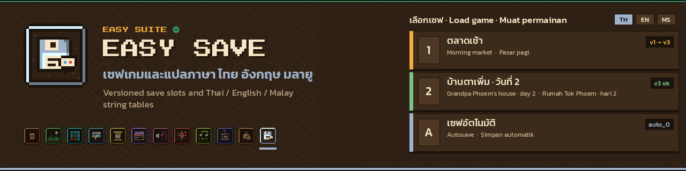
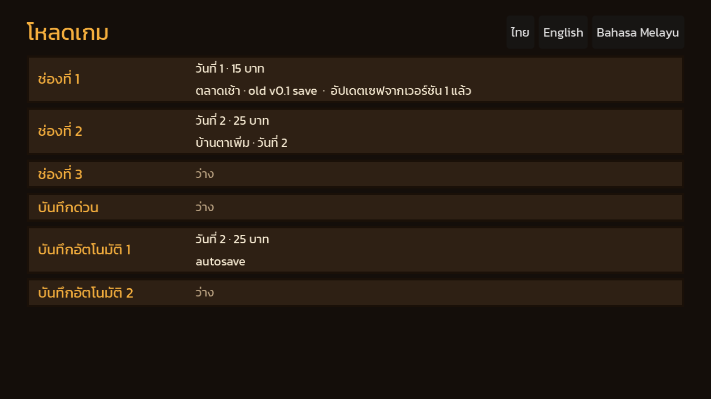
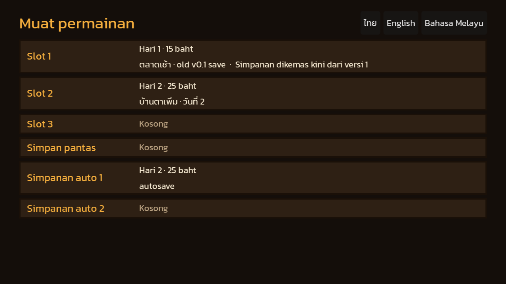
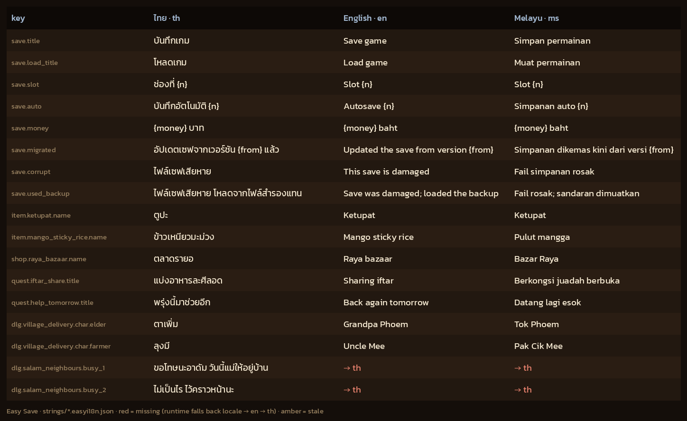
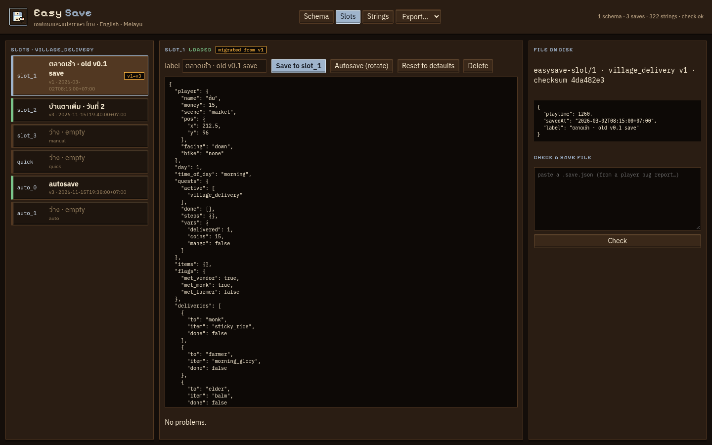
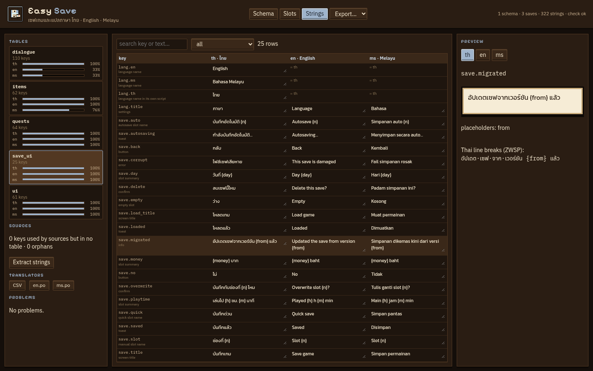

<!-- easy-suite:header:start -->
<p align="center">
  <a href="#easy-suite"></a>
</p>

<p align="center">
  <b>Easy Save</b> · เซฟเกมและแปลภาษา ไทย อังกฤษ มลายู · Versioned save slots and Thai / English / Malay string tables<br />
  <sub>Part of <a href="#easy-suite"><b>Easy Suite</b></a>: Thai-friendly pixel-art game dev tools for Godot 4.3+ and PixiJS v8</sub>
</p>

<p align="center">
  <a href="https://github.com/Saladin2020/easysave/actions/workflows/ci.yml"></a> <a href="LICENSE"></a>  <a href="#export"></a> <a href="docs/MCP.md"></a> 
</p>

<p align="center">
  <a href="https://github.com/Saladin2020/easysprite"></a>
  <a href="https://github.com/Saladin2020/easyscene"></a>
  <a href="https://github.com/Saladin2020/easytilemap"></a>
  <a href="https://github.com/Saladin2020/easydialogue"></a>
  <a href="https://github.com/Saladin2020/easyquest"></a>
  <a href="https://github.com/Saladin2020/easyui"></a>
  <a href="https://github.com/Saladin2020/easysfx"></a>
  <a href="https://github.com/Saladin2020/easyfx"></a>
  <a href="https://github.com/Saladin2020/easymusic"></a>
  <a href="https://github.com/Saladin2020/easyanim"></a>
  <a href="https://github.com/Saladin2020/easyitems"></a>
  <a href="https://github.com/Saladin2020/easysave"></a>
</p>
<!-- easy-suite:header:end -->

# Easy Save

**เซฟเกมหลายช่อง มีเวอร์ชันและตัวแปลงเซฟเก่า กันไฟล์เสียด้วย checksum และตารางข้อความ ไทย · English · Melayu**  
Describe what a game saves in a small schema (`easysave/1`): typed fields with defaults, slots (manual, quick,
autosave rotation) and **migrations** that turn a v1 save into the current version. Every slot file carries an
FNV-1a checksum over canonical JSON, so a hand-edited or truncated save is caught and the previous file (`.bak`)
loads instead. Next to the saves sit **string tables** (`easyi18n/1`): one key per text, Thai source, English and
Malay translations, extracted from your Easy Dialogue, Quest, UI and Items files, with CSV / PO round trips for
translators. Exports a **Godot 4.3+** setup (`SaveManager` and `I18n` autoloads, TranslationServer CSV, Kanit
font) or a **web / PixiJS** runtime (localStorage slots + i18n). CLI, web editor and MCP server; local only.

| Godot demo (`main.tscn`, Thai) | Same slots in Malay |
|---|---|
|  |  |

<p align="center"></p>

## Sample

`easysave init` copies one small game, **ต้นส่งของรอบหมู่บ้าน · Ton's village deliveries**:

- `schemas/village_delivery.easysave.json` v3: player (name, money, scene, position, bike), day and time of day,
  Easy Quest state, Easy Items bag, flags, deliveries, settings (locale, text speed, volumes), stats.
  3 manual slots, a quick slot, autosave every 120 s keeping 2.
- Migrations v1→v2→v3 using every op: `rename` (coins → money), `wrap` (x, y → pos), `map` (`"yes"`/`"no"` flags
  → booleans, `"fast"` → 3), `add`, `copy`, `delete` (an old debug flag) and wildcard renames inside the deliveries list.
- `saves/`: `slot_1` written by v1 of the game (loads through both migrations), `slot_2` and `auto_0` at v3.
- `strings/`: 322 keys in five tables: `dialogue` (two .ezd files), `quests` (Ramadan/Raya and delivery quests),
  `ui`, `items` (village and Raya bazaar) and `save_ui` (save/load screen). `salam_neighbours` dialogue is left
  untranslated on purpose so the fallback and `--missing` reports have something to show.

## Quick start

```bash
npm install
npx tsx src/cli.ts init --workspace ~/mygame-save     # or: npm run build && node dist/cli.js …
cd ~/mygame-save
easysave check                    # schema, every save (checksum, migration, fields), string tables
easysave slots                    # slot_1 ok v1 · ตลาดเช้า … (migrates on load)
easysave migrate saves/slot_1.save.json --out /tmp/slot_1.v3.json
easysave extract                  # pull new text from sources/ into strings/ (changed lines → stale)
easysave strings --missing --locale ms
easysave strings-export --format po && easysave strings-import exports/strings/strings.ms.po
easysave export --preset all      # exports/easysave-godot, easysave-web, easysave-strings
easysave serve                    # web editor on http://127.0.0.1:8898
```

`EASYSAVE_WORKSPACE` (or `EASYSAVE_HOME`) replaces `--workspace`. Every command takes `--json` where it prints data.

| Command | |
|---|---|
| `init [--force]` | Create `schemas/ saves/ strings/ sources/ exports/` with the sample |
| `info`, `schema [id]`, `defaults [--out]` | Summary, schema tree with migrations, a fresh save's data |
| `check [--strict]` | Everything; `--strict` also fails on missing translations and keys sources use but no table has |
| `verify <file>`, `migrate <file> [--out]` | One save file: checksum, version, fields; run migrations and write a new v-current slot |
| `save <slot\|auto> [--data f] [--label]`, `slots` | Write a slot (keeps `.bak`; `auto` rotates), list slots |
| `extract [--from p] [--prune] [--dry-run]` | Sources → string tables |
| `strings [--missing] [--locale] [--table] [--keys]` | Coverage, untranslated keys, source keys missing from tables |
| `strings-export --format csv\|po`, `strings-import <file>` | Translator round trip (empty cells never erase) |
| `fonts` | Thai font and line-breaking notes |
| `export --preset godot\|web\|strings\|all [--out]`, `serve [--port] [--dev]` | Export, web editor |

## The format

Full reference: [docs/FORMAT.md](docs/FORMAT.md).

```jsonc
{ "format": "easysave/1", "id": "village_delivery", "version": 3,
  "slots": { "manual": 3, "quick": true, "autosave": { "intervalSec": 120, "keep": 2 } },
  "fields": {
    "player": { "type": "object", "fields": {
      "money": { "type": "int", "default": 0, "min": 0 },
      "pos":   { "type": "object", "fields": { "x": { "type": "float" }, "y": { "type": "float" } } } } },
    "flags":  { "type": "map", "of": { "type": "bool" } } },
  "migrations": [
    { "from": 1, "to": 2, "ops": [ { "op": "rename", "from": "player.coins", "to": "player.money" },
                                   { "op": "map", "path": "flags.*", "values": { "yes": true, "no": false } } ] } ] }
```

A slot file is `{ format: "easysave-slot/1", game, version, slot, meta { savedAt, playtime, label, locale }, data, checksum }`.
The checksum covers `game`, `version`, `meta` and `data` (not the slot name, so files can move between slots).
Loading: verify checksum → refuse other games and newer versions → migrate → normalise (fill defaults, drop unknown
fields, check types and ranges). Any failure falls back to `<slot>.save.json.bak`.

String tables: `{ format: "easyi18n/1", id, source: "th", locales, strings: { key: { th, en, ms, note, src, stale, max, fixed } } }`.
`{name}` placeholders must match the Thai source; `check` also flags Thai script left in en/ms (the ฿ sign is fine),
over-long UI text (`max`) and stale translations. Runtime fallback: current locale → en → th → the key itself.

## Export

| Preset | Output |
|---|---|
| `godot` | `project.godot` with `SaveManager` + `I18n` autoloads, `easysave/schema.json`, `save_manager.gd`, `i18n.gd`, `i18n/strings.csv` (imported to `.translation` per locale, every cell filled with its fallback), Kanit as the project font, a save/load demo (`main.tscn`, `--lang=ms`) and `test_save.gd` |
| `web` | `easysave-core.js` (no deps), `easysave-web.js` (`loadEasySave()` over localStorage), `schema.json`, `strings.json`, sample saves, Kanit, `index.html` demo |
| `strings` | `strings.csv`, `en.po`, `ms.po`, merged `strings.json`, the tables, `FONTS.txt` |

Godot:

```gdscript
SaveManager.save_slot("slot_1", state, {"label": "ตลาดเช้า"})
var r := SaveManager.load_slot("slot_1")        # {ok, data, meta, migrated_from, used_backup, reason}
SaveManager.start_autosave(func(): return state) # every schema.slots.autosave.intervalSec
I18n.set_locale("ms")
label.text = I18n.t("save.slot", {"n": 2})      # or tr("save.slot") — TranslationServer has the same keys
```

Web / PixiJS:

```js
import { loadEasySave } from "./easysave-web.js";
const es = await loadEasySave(".");
es.saves.save("slot_1", state, { label: "ตลาดเช้า" });
const r = es.saves.load("slot_1");
const stop = es.startAutosave(() => state);
es.setLocale("ms"); text.text = es.i18n.tw("save.title");   // tw() adds Thai word-break hints for PixiJS Text
```

Canonical JSON and the checksum are implemented twice (TypeScript and GDScript) with one number rule, and the
Godot test checks them against values the TypeScript core computed; a save Godot writes verifies in TypeScript.

## Web editor

`easysave serve` → http://127.0.0.1:8898 (`--dev` serves the API only; run Vite on :5186).

- **Slots**: every slot with status, version and label; load (shows migration and backup use), edit the data,
  save, autosave, delete; paste a player's save file to see why it fails.
- **Strings**: coverage per table and locale, an editable key × th/en/ms grid (missing in red, stale in amber),
  a Kanit dialogue-box preview with fallbacks, extract, CSV / PO downloads.
- **Schema**: field tree, slots, migrations, the schema JSON with validate / save, a migration sandbox.

| Slots | Strings |
|---|---|
|  |  |

## MCP server

`npm run mcp` (stdio) or `npm run mcp:http` (http://127.0.0.1:8899/mcp). 11 tools: `workspace_info`, `get_schema`,
`write_schema`, `list_slots`, `validate_save`, `migrate_save`, `list_strings`, `set_strings`, `extract_strings`,
`check_all`, `export_save`. See [docs/MCP.md](docs/MCP.md).

## Ports

| | Default |
|---|---|
| Web editor / API (`serve`) | 8898 |
| MCP over HTTP | 8899 |
| Vite dev UI | 5186 |

Other Easy Suite tools: Easy FX 8848 / 8849 / 5180, Easy Items 8878 / 8879 / 5185. Binding to a non-loopback host
prints a token that every request must carry (`EASYSAVE_TOKEN` fixes it).

## Development

```bash
npm run typecheck && npm test        # vitest; GODOT=/path/to/godot npm test also runs the Godot check
npm run smoke                        # MCP (stdio + HTTP) and CLI smoke tests
npm run build                        # runtime/web/easysave-core.js (esbuild from src/core), dist/, web/dist/
npm run check:web -- exports/easysave-web   # headless Chrome: save, reload, tamper → .bak, autosave, locales
python3 scripts/i18n-table.py samples docs/assets/i18n-table.png
```

`src/core` is browser-safe and is the single source for the web runtime; `test/runtime.test.ts` fails when
`runtime/web/easysave-core.js` is out of date.

<!-- easy-suite:table:start -->
## Easy Suite


Twelve small, local-first tools that share one look (teak, lantern gold, Kanit, 16/48px pixels), one
workflow (CLI · web editor · MCP server) and the same targets (**Godot 4.3+** and **PixiJS v8**).
ชุดเครื่องมือทำเกมพิกเซลสไตล์ไทย ใช้ร่วมกันได้ทั้งชุด  
The samples share one multicultural southern Thai village: Buddhist temple, wooden kampung mosque and
Chinese-Thai shrine on the same street. หมู่บ้านพหุวัฒนธรรม วัด มัสยิด ศาลเจ้า อยู่ร่วมกันในเมืองเดียว

| | Tool | What it does | Repo |
|:-:|---|---|---|
|  | [**Easy Sprite**](https://github.com/Saladin2020/easysprite) | Compose modular 48px chibi characters (top-down + side-view) and export sheets. | [`easysprite`](https://github.com/Saladin2020/easysprite) |
|  | [**Easy Scene**](https://github.com/Saladin2020/easyscene) | Side-view levels: parallax layers, 16px autotiles, Thai town props. | [`easyscene`](https://github.com/Saladin2020/easyscene) |
|  | [**Easy Tilemap**](https://github.com/Saladin2020/easytilemap) | Top-down 16px maps: blob-47 autotiles, objects, collision, spawns. | [`easytilemap`](https://github.com/Saladin2020/easytilemap) |
|  | [**Easy Dialogue**](https://github.com/Saladin2020/easydialogue) | Branching `.ezd` dialogue with Thai-safe text, portraits and choices. | [`easydialogue`](https://github.com/Saladin2020/easydialogue) |
|  | [**Easy Quest**](https://github.com/Saladin2020/easyquest) | Text `.ezq` quests: steps, flags, items, rewards, linked to dialogue. | [`easyquest`](https://github.com/Saladin2020/easyquest) |
|  | [**Easy UI**](https://github.com/Saladin2020/easyui) | Nine-slice pixel UI kit: panels, bars, inventory, menus, 30 icons. | [`easyui`](https://github.com/Saladin2020/easyui) |
|  | [**Easy SFX**](https://github.com/Saladin2020/easysfx) | Deterministic 8-bit SFX and 4-channel chiptune loops, typing blips. | [`easysfx`](https://github.com/Saladin2020/easysfx) |
|  | [**Easy FX**](https://github.com/Saladin2020/easyfx) | Pixel particles: sparks, fire, rain, lanterns, Raya pelita; sheets + Godot particles. | [`easyfx`](https://github.com/Saladin2020/easyfx) |
|  | [**Easy Music**](https://github.com/Saladin2020/easymusic) | Seeded Thai loop music: ranat, khong wong, saw, khim, pi, kompang; seamless WAV/OGG loops. | [`easymusic`](https://github.com/Saladin2020/easymusic) |
|  | [**Easy Anim**](https://github.com/Saladin2020/easyanim) | Cutscene timelines: actors, camera, dialogue, FX and music cues; Godot + Pixi runners. | [`easyanim`](https://github.com/Saladin2020/easyanim) |
|  | [**Easy Items**](https://github.com/Saladin2020/easyitems) | Item database, shops, inventory, loot tables and crafting; 44 starter items with pixel icons. | [`easyitems`](https://github.com/Saladin2020/easyitems) |
|  | **Easy Save** ← you are here | Versioned save slots with migrations and checksums; Thai / English / Malay string tables. | [`easysave`](https://github.com/Saladin2020/easysave) |

### Works with

- **Easy Dialogue / Easy Quest / Easy UI / Easy Items**: `easysave extract` reads `.ezd` (or compiled `.dialogue.json`), `.ezq`, `.easyui.json` and `.easyitems.json` and keeps one key per line, quest title, widget label and item name. Line keys match the ids Easy Dialogue compiles, so a translated table drops straight into its runtime.
- **Easy Quest** runner state (`active`, `done`, `steps`, `vars`) and **Easy Items** `Items.to_dict()` are fields in the sample schema; a save slot stores them as they are.
- **Easy Tilemap / Easy Scene** spawn ids are the `player.scene` field; **Easy UI** save/load screens use the `save.*` strings in `save_ui`.
<!-- easy-suite:table:end -->

## Credits

Sample schema, saves, strings and sources are written for this repo and dedicated to the public domain (CC0 1.0). Kanit is bundled under the SIL OFL 1.1. See [CREDITS.md](CREDITS.md). Code: MIT.
